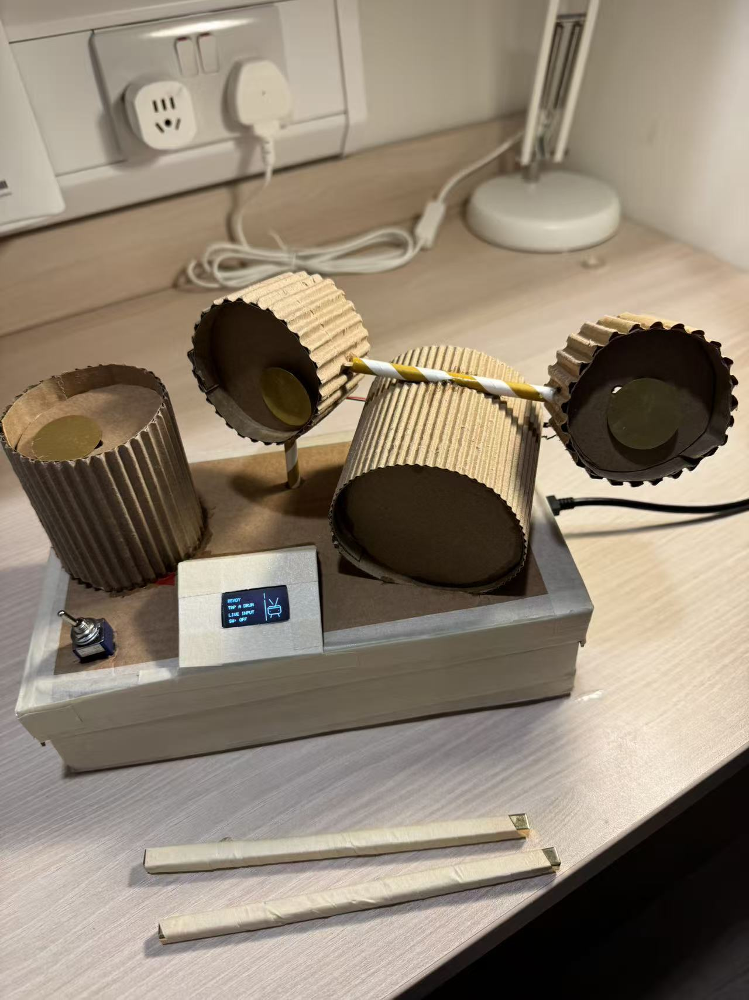

# Rhythm of Light 🥁

**An interactive cardboard drum that turns rhythm into colour, sound and play.**  
*CASA0014 Connected Environments · UCL*

## About the project

I wanted to explore how a simple handmade instrument could create a more visual experience of rhythm. **Rhythm of Light** uses three piezoelectric drum pads to control 72 RGB LEDs through an Arduino MKR WiFi 1010 and MQTT.

Each pad has its own colour family. Softer and stronger hits produce different colours and brightness levels, which gradually fade. When two or three pads are hit together, their colours blend across the active sections. A buzzer and OLED screen add sound and on-device feedback.

The project also includes experimental rhythm recording, replay and a two-player imitation game.

## Features

- **Three responsive pads** — separate sensors on A0, A1 and A2.
- **Expressive lighting** — strength-based colours, fading and simultaneous-hit blending across three 24-LED zones.
- **Sound feedback** — one passive buzzer plays different tones for drum hits.
- **Live display** — OLED shows the drum number, hit strength and recording/game status.
- **Interactive modes** — an external toggle switch controls recording, replay and imitation-game stages.

## Hardware

| Component | Purpose |
| --- | --- |
| Arduino MKR WiFi 1010 | Reads inputs and communicates over Wi-Fi/MQTT |
| 3 piezoelectric discs (A0–A2) | Sense vibrations from each drum pad |
| Resistors and 1N4007 diodes | Components used in the piezo input circuits |
| 72 RGB LEDs (3 × 24) | Visual response, controlled via Vespera/MQTT |
| Passive buzzer (D3) | Audio feedback |
| 128 × 64 I²C OLED (SDA/SCL) | Displays hits, strength and mode changes |
| External toggle switch (D2) | Physical interaction control |
| Breadboards, jumper wires and cardboard | Prototyping, connections and enclosure |

The piezo discs are mounted beneath the cardboard playing surfaces. How they are fixed, and how securely their wires connect, has a noticeable effect on sensitivity. The diodes are part of the prototype circuit; the final piezo input protection should be checked before long-term use.

**Diagrams:** [Concept](Diagram/Concept%20diagram.jpg) · [System](Diagram/System%20diagram.png) · [Circuit](Diagram/Circuit%20diagram.png) · [Wiring documentation](Diagram/)

## Development

The project started with **one piezo sensor and a basic light response**. I expanded it to three pads, then adjusted the colour palettes, sensitivity, fade duration and behaviour when multiple drums are played together. I later added the buzzer, OLED and external switch, followed by recording/replay and imitation-scoring experiments. The Git commit history documents these iterations.

## Testing & Evaluation

The [Test/](Test/) folder contains separate sketches for piezo signals, hit detection, MQTT lighting, buzzer, OLED, recording and imitation scoring.

| Test | Result / observation |
| --- | --- |
| **Piezo sensors** | All three responded to tapping. Idle signal peaks were about **3 (A0), 20 (A1), 21 (A2)** in one test; different tap forces mean the peak values are not calibrated measurements of strength. |
| **Hit detection** | Drums 2 and 3 occasionally reported hits while untouched, especially at the start. Individual thresholds and mounting need further tuning. |
| **Lighting** | Drum hits changed LED colour; strength changes, gradual fading and multi-pad blending were observed. |
| **Buzzer and OLED** | The buzzer produced tones and the OLED displayed live hit information. |
| **Recording and replay** | Event timing and replay were implemented in test code, but need further checks on the finished drum. |
| **Imitation scoring** | Sample-sequence checks gave **100** for three matching hits and **67** with one missing or incorrect hit. This is a logic test, not a full two-player playtest. |

## Reflection & Future Work

**What worked:** The three-pad interaction makes the lights feel connected to physical rhythm. Mixing colours for combined hits was especially interesting.

**What was difficult:** Sensitivity varied between the pads, and loose jumper connections or vibrations sometimes caused missed or false triggers. The passive buzzer provides feedback but does not sound like a real drum.

**Next steps:** Improve sensor mounting and replace connections with locking connectors; tune thresholds through repeated tests; try a small speaker and audio playback module; and add microSD storage so recordings survive power-off. I would also try to add more funtions to make it more intertsting.

## Getting started

1. Open [vespera_drum_controller.ino](firmware/vespera_drum_controller/vespera_drum_controller.ino) in the Arduino IDE and select **Arduino MKR WiFi 1010**.
2. Install the libraries **WiFiNINA**, **PubSubClient**, **Adafruit GFX** and **Adafruit SSD1306**.
3. Copy the provided secrets template to a file named arduino_secrets.h in the same sketch folder. Add your own network and MQTT settings. **Never commit real credentials.**
4. Connect the sensors and other components according to the wiring diagrams, then upload the sketch. The RGB LEDs are controlled remotely through the Vespera/MQTT setup, **not directly from the Arduino pins**.

### Repository structure

| Location | Contents |
| --- | --- |
| [firmware/vespera_drum_controller/](firmware/vespera_drum_controller/) | Main Arduino program and secrets template |
| [Test/](Test/) | Individual hardware and interaction test sketches |
| [Diagram/](Diagram/) | Concept, circuit, wiring and final prototype images |

---

